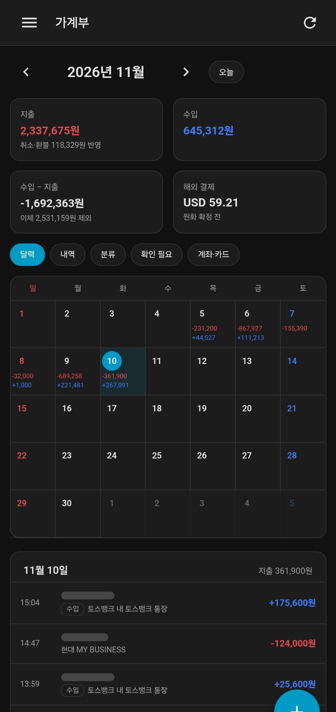
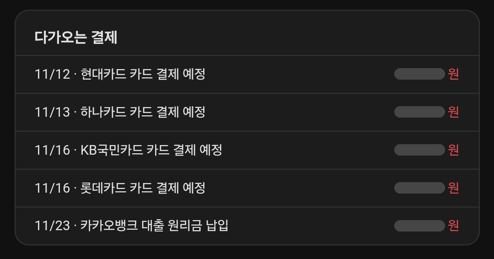
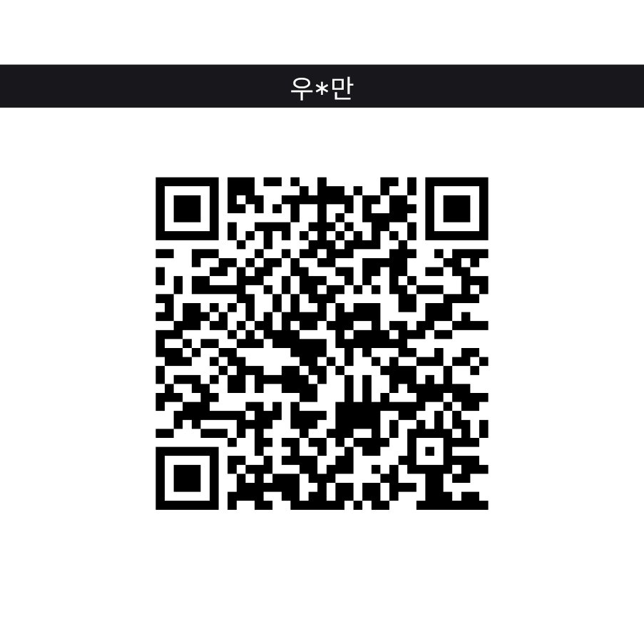
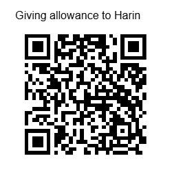

<p align="center">
  <a href="https://github.com/redchupa/kr_ledger_kit/releases/latest"></a>
  <a href="https://github.com/hacs/integration"></a>
  
  
  <a href="LICENSE"></a>
</p>

<p align="center">
  <b>🌐 Language:</b> <a href="README.md">🇰🇷 한국어</a> · <b>🇬🇧 English</b>
</p>

# KR Ledger — a Home Assistant household ledger that fills itself from notifications

KR Ledger reads the **card, bank and pay notifications** that already arrive on your Android phone
(Korean card approval SMS, bank app pushes, Samsung Pay, KakaoTalk 알림톡) and turns them into a
**daily household ledger** inside Home Assistant, with a sidebar panel, sensors and automation events.

No bank login, no cloud, no manual entry. All data stays in your Home Assistant.

> This integration targets **Korean** financial notification formats. Notifications from other
> countries are not parsed.

### 📸 Screenshots

<table>
  <tr>
    <td align="center" valign="top" width="40%">
      <br/>
      <sub><b>Calendar and monthly summary</b><br/>spending (red) and income (blue) per day; tap a day for its entries</sub>
    </td>
    <td align="center" valign="top" width="60%">
      <br/>
      <sub><b>Upcoming bills</b><br/>card bill and loan reminders collected from notifications</sub>
      <br/><br/>
      <sub>Taken in the HA companion app (dark theme).<br/>Merchant names and bill amounts are hidden.</sub>
    </td>
  </tr>
</table>

---

## How it works

```
card payment / bank transfer
        ↓
notification on the phone (card SMS · card app · bank app · Samsung Pay · KakaoTalk 알림톡)
        ↓
HA companion app sensors  →  KR Ledger
   1. drops personal SMS / chats / OTP codes immediately (never stored)
   2. parses amount, merchant, time and card per issuer format
   3. merges several notifications about the same payment into one entry
   4. excludes transfers between your own accounts and card-bill payments
        ↓
SQLite ledger in /config/kr_ledger  →  sidebar panel · sensors · automations
```

## Requirements

| | |
|---|---|
| Phone | **Android** with the Home Assistant companion app (iOS has no notification sensors) |
| Home Assistant | 2025.8 or newer |
| HACS | or the built-in Marketplace on HA 2026.11+ |

## Step 1 — enable two notification sensors on the phone

In the companion app: **Settings → Companion app → Manage sensors**.

1. **Last notification** — enable it, grant notification access, and in its **Allow list** select your
   SMS app, card apps, bank apps and Samsung Wallet (and KakaoTalk if your card company uses 알림톡).
2. **Active notification count** — enable it too. **This one is required.**

Why both? Samsung Pay and Samsung Messages post the real notification followed by an empty group
summary within the same second, and the *Last notification* sensor often keeps only the empty summary.
In real data 6 of 7 Samsung Pay notifications arrived without content and one payment was lost
completely. *Active notification count* reports every notification currently in the shade, with its
content, which closes that gap. Both sensors are de-duplicated, so nothing is recorded twice.

Check in **Developer tools → States** that both `sensor.<phone>_last_notification` and
`sensor.<phone>_active_notification_count` exist.

## Step 2 — install with HACS

HACS → ⋮ → **Custom repositories** → `https://github.com/redchupa/kr_ledger_kit`, type **Integration**
→ download **KR Ledger** → restart Home Assistant.

## Step 3 — add the integration

**Settings → Devices & services → Add integration → KR Ledger**

| Field | |
|---|---|
| Notification sensors | select **both** sensors from step 1 (and family phones' sensors if you like) |
| Your names | used to detect transfers between your own accounts; masked forms like `홍*동` match automatically |
| Import past days | default 10 — recorder history is replayed so the last ~10 days appear immediately |

A **가계부 (Ledger)** item appears in the sidebar.

## Features

- Monthly calendar with daily spending / income, daily list, category breakdown, upcoming bills
  (card bills, loan payments, phone / utility bills and tax notices)
- One payment reported by SMS + card app + Samsung Pay → **one entry**
- Cancellations subtract from spending; foreign-currency payments are totalled separately
- Own-account transfers and card-bill payments are not counted as spending
- Change a category once and future payments at that merchant follow it
- Mark accounts personal / business, or exclude a card from the totals
- Manual entries for cash
- Sensors: today's spending, month spending / income, last transaction, notifications to review
- Event `kr_ledger_transaction` for automations; services `import_history`, `add_transaction`,
  `delete_transaction`, `reprocess`

## Privacy

- Nothing is sent anywhere; the integration works offline.
- Personal SMS, personal chats and OTP messages are dropped before anything is stored.
- Data lives only in `/config/kr_ledger/ledger.db` and is included in HA backups.

## Families: family cards and iPhones

KR Ledger can only read payments whose notifications arrive on an **Android** phone running the companion app.

- **iPhones can't be used.** iOS doesn't let apps read other apps' notifications, so the iOS companion app has no notification sensors.
- **Family cards notify the person using them.** A family card issued in your name usually sends its approval SMS / app alerts to the family member's phone, not yours, so those payments never reach KR Ledger.

What to do:

| Situation | Fix | Result |
|---|---|---|
| Family member uses an iPhone (most common) | Ask the card company for the service that also sends family-card approvals to the **primary cardholder** ("가족카드 이용내역 본인 수신") | Each family-card payment also texts your phone and is recorded automatically, as a **separate card** (different card number) |
| The card company has no such service | Let the family member use your own card instead | Recorded, but you can no longer tell who paid |
| Family member uses Android | Set up step 1 on their phone and add their two sensors in KR Ledger's options | Their notifications land in the same ledger |

Rename the family card in the panel's **계좌·카드 (accounts)** tab, e.g. "spouse's card", to see at a glance who paid.

## Contributing

Unrecognised formats show up in the panel's **확인 필요 (review)** tab. Please report them with names,
card and account numbers removed: [new format report](https://github.com/redchupa/kr_ledger_kit/issues/new?template=new_format.yml).
The parser (`custom_components/kr_ledger/engine/`) has no Home Assistant dependency; see
[CONTRIBUTING.md](CONTRIBUTING.md).

## ☕ Support

If KR Ledger is useful to you, a coffee helps a lot 🙏

<table>
  <tr>
    <td align="center"><b>Toss</b><br/></td>
    <td align="center"><b>PayPal</b><br/></td>
  </tr>
</table>

<p align="center">
  <a href="https://github.com/sponsors/redchupa"></a>
  <a href="https://www.paypal.com/redchupa"></a>
</p>

If it worked for you, a ⭐ on the repository helps others find it.

## License

MIT — [LICENSE](LICENSE)
