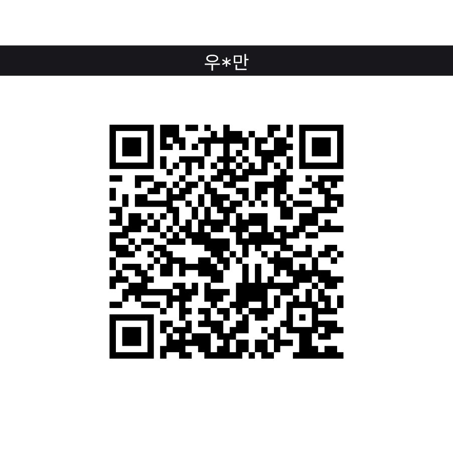
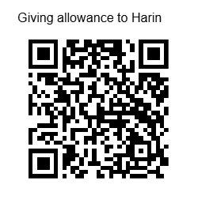

<p align="center">
  <a href="https://github.com/redchupa/kr_ledger_kit/releases/latest"></a>
  <a href="https://github.com/hacs/integration"></a>
  
  
  <a href="https://github.com/redchupa/kr_ledger_kit/actions/workflows/ci.yml"></a>
  <a href="LICENSE"></a>
  
</p>

<p align="center">
  <a href="https://github.com/redchupa/kr_ledger_kit/stargazers"></a>
  <a href="https://github.com/redchupa/kr_ledger_kit/issues"></a>
  <a href="https://github.com/redchupa/kr_ledger_kit/commits/main"></a>
</p>

<p align="center">
  <b>🌐 Language:</b> <b>🇰🇷 한국어</b> · <a href="README.en.md">🇬🇧 English</a>
</p>

# KR Ledger — 알림으로 자동 기록되는 Home Assistant 가계부

카드 승인 문자, 카드사 앱, 은행 앱, 삼성페이 알림을 **자동으로 읽어서 날짜별 가계부**를 만들어 주는
Home Assistant 통합입니다. 결제할 때마다 폰에 오는 알림이 그대로 가계부가 됩니다.

```
📱 [Web발신] 메가커피 12,800원 승인 …        →   🗓️ 11월 10일  식비  메가커피  -12,800원
📱 카카오뱅크  출금 200,000원 생활비 → 집주인   →   🗓️ 11월 10일  주거  집주인    -200,000원
📱 삼성페이  ₩19,800 결제 완료  과일가게        →   (위 카드 문자와 같은 결제면 1건으로 합침)
```

> 💡 직접 입력할 필요가 없는 가계부입니다. 앱 설치 · 회원가입 · 은행 연동 없이,
> **이미 폰에 오고 있는 알림**만으로 동작하고 **모든 데이터는 내 HA 안에만** 저장됩니다.

---

## 📑 목차

- [어떻게 동작하나요? (3분 만에 큰 그림)](#-어떻게-동작하나요-3분-만에-큰-그림)
- [이 가이드를 따라가면 무엇이 됩니까](#-이-가이드를-따라가면-무엇이-됩니까)
- [시작 전 알아둘 것 (꼭 읽어주세요)](#-시작-전-알아둘-것-꼭-읽어주세요)
- [1단계 · 폰에서 알림 센서 2개 켜기](#1단계--폰에서-알림-센서-2개-켜기)
- [2단계 · HACS로 설치](#2단계--hacs로-설치)
- [3단계 · HA에 KR Ledger 추가](#3단계--ha에-kr-ledger-추가)
- [4단계 · 가계부 패널 사용법](#4단계--가계부-패널-사용법)
- [지원하는 알림](#-지원하는-알림)
- [중복·이체·취소는 어떻게 처리하나요](#-중복이체취소는-어떻게-처리하나요)
- [센서 · 이벤트 · 서비스 · 자동화 예시](#-센서--이벤트--서비스--자동화-예시)
- [옵션 설명](#️-옵션-설명)
- [🔐 개인정보 — 안심하고 쓰셔도 됩니다](#-개인정보--안심하고-쓰셔도-됩니다)
- [잘 안 될 때](#-잘-안-될-때)
- [자주 묻는 질문](#-자주-묻는-질문)
- [새 카드사 형식 제보 · 개발 참여](#-새-카드사-형식-제보--개발-참여)
- [☕ 후원](#-후원)
- [⭐ 별 한 번 부탁드려요](#-별-한-번-부탁드려요--다른-분들도-찾을-수-있도록)
- [라이선스](#라이선스)

---

## 🔍 어떻게 동작하나요? (3분 만에 큰 그림)

```
[카드 결제 / 계좌 입출금]
        ↓
[폰에 알림 도착]  카드 문자 · 카드사 앱 · 은행 앱 · 삼성페이 · 카카오톡 알림톡
        ↓
[HA 컴패니언 앱이 알림 내용을 HA로 전송]   ← 1단계에서 켜는 센서 2개
        ↓
[KR Ledger]
   ① 개인 문자·개인 카톡·인증번호는 즉시 버림 (저장 안 함)
   ② 카드사·은행별 형식으로 금액·가맹점·시각·카드 해석
   ③ 같은 결제가 여러 알림으로 오면 1건으로 합침
   ④ 본인 계좌 간 이체·카드대금은 지출에서 제외
        ↓
[HA 안의 가계부 DB]  →  사이드바 "가계부" 패널 · 센서 · 자동화
```

설치할 때 한 번:

1. 폰의 HA 컴패니언 앱에서 **알림 센서 2개** 켜기 — 약 5분
2. **HACS로 KR Ledger 설치** — 약 5분
3. HA에서 **통합 추가** (센서 선택 + 본인 이름 입력) — 약 3분
4. 사이드바 **가계부** 열기 → HA에 남아 있는 최근 약 10일치 결제가 바로 보임 ✨

그 후로는 아무것도 안 해도 됩니다. 결제하면 몇 초 안에 가계부에 들어옵니다.

---

## ✨ 이 가이드를 따라가면 무엇이 됩니까

- 사이드바에 **가계부** 메뉴: 월간 **달력**(날짜별 지출·수입) · 일별 **내역** · **분류**별 지출 · 다가오는 결제
- **카드 문자 + 카드앱 + 삼성페이**가 같은 결제를 3번 알려도 **1건**으로 기록
- **승인 취소**는 지출에서 자동 차감, **해외 결제(USD 등)** 는 따로 집계
- **본인 계좌끼리 옮긴 돈**과 **카드대금 납부**는 지출로 세지 않음 (이중 계산 방지)
- **카드 결제 예정 · 대출 납입 예정** 안내 문자 → 달력에 "예정"으로 표시
- 분류(식비·쇼핑·교통…)를 한 번 고치면 **같은 가게는 다음부터 자동 분류**
- **개인 / 사업** 계좌 구분, 법인카드처럼 가계부에서 빼고 싶은 카드는 **제외** 가능
- 현금 등 알림이 없는 거래는 **직접 추가**
- HA 센서(오늘 지출 · 이번 달 지출/수입 · 최근 거래)와 **자동화 이벤트** 제공
  → "10만 원 넘게 결제되면 스피커로 알려줘" 같은 자동화 가능

> ⏱️ 끝까지 따라하는 데 **15~20분** 정도 걸립니다.

---

## 🧭 시작 전 알아둘 것 (꼭 읽어주세요)

| 필요한 것 | 설명 |
|---|---|
| **안드로이드 폰** | 결제 알림을 받는 폰. **아이폰은 지원하지 않습니다** (iOS 컴패니언 앱에는 알림 센서가 없음). |
| **Home Assistant 2025.8 이상** | 아직 없으시면 → ▶ **[Home Assistant 입문 가이드 (한국어 블로그)](https://redchupa.com/entry/%ed%99%88%ec%96%b4%ec%8b%9c%ec%8a%a4%ed%84%b4%ed%8a%b8ha-%ec%9e%85%eb%ac%b8-%ea%b0%80%ec%9d%b4%eb%93%9c/)**<br/>**버전 확인**: HA 좌측 사이드바(모바일은 좌상단 ☰) → **설정** → **정보** |
| **HA 컴패니언 앱** | 결제 알림을 받는 폰에 설치하고 내 HA에 로그인되어 있어야 합니다. [Play 스토어](https://play.google.com/store/apps/details?id=io.homeassistant.companion.android) |
| **HACS** | 커뮤니티 통합을 설치하는 "앱스토어". HA 2026.11부터는 **Marketplace** 라는 이름으로 기본 포함되어 있습니다. 이전 버전은 [HACS 설치 가이드](https://www.hacs.xyz/docs/use/download/download/) 참고 |
| **결제 알림이 오는 상태** | 카드사 승인 문자 또는 카드사/은행 앱 푸시 알림이 폰에 오고 있어야 합니다. 꺼져 있으면 각 카드사 앱에서 켜 주세요. |

> 💡 **메뉴가 영어로 보이는 분께**: 설정 = Settings · 기기 및 서비스 = Devices & services ·
> 통합 추가 = Add integration · 구성 = Configure · 개발자 도구 = Developer tools · 상태 = States

---

# 1단계 · 폰에서 알림 센서 2개 켜기

KR Ledger는 HA 컴패니언 앱이 보내 주는 **알림 센서 2개**를 읽습니다.

| 센서 | 역할 | 필수? |
|---|---|---|
| **Last notification** (마지막 알림) | 새 알림이 올 때마다 그 내용을 하나씩 보냄 | ✅ 필수 |
| **Active notification count** (활성 알림 수) | 알림창에 떠 있는 **모든 알림을 내용과 함께** 보냄 | ✅ **필수** (강력 권장) |

### ⚠️ 왜 2개가 다 필요한가요?

결제 한 번에 **카드 문자 · 카드사 앱 · 삼성페이 알림이 거의 같은 순간**에 옵니다.
게다가 삼성페이와 삼성 메시지 앱은 실제 알림 바로 뒤에 **내용 없는 "묶음 알림"** 을 하나 더 띄웁니다.
그러면 `Last notification` 센서에는 **빈 묶음 알림만 남고 진짜 결제 알림이 사라지는** 일이 생깁니다.

> 📊 실제 사용 데이터로 확인한 결과: 삼성페이 결제 알림 **7건 중 6건**이 내용 없이 들어왔고,
> 그중 **1건은 다른 알림도 같이 묻혀서 가계부에서 통째로 빠졌습니다.**

`Active notification count` 센서는 알림창에 떠 있는 알림 전체를 내용과 함께 보내 주기 때문에
이 빈자리를 채워 줍니다. 두 센서가 같은 알림을 보내도 **가계부에는 한 번만** 기록되니 걱정하지 마세요.

## 1-1. 컴패니언 앱 설정 열기

1. 결제 알림을 받는 폰에서 **Home Assistant 앱** 실행
2. 좌측 메뉴(☰) → **설정** → **컴패니언 앱**
3. **센서 관리** 누르기

## 1-2. Last notification 켜기

1. 센서 목록에서 **알림 센서** 묶음을 찾아 **Last notification** 누르기
2. **센서 사용** 스위치 켜기
3. "알림 접근 허용" 화면이 나오면 **Home Assistant** 를 찾아 **허용**
   - 안 나오면: 폰 **설정 → 애플리케이션 → 특별한 접근 → 알림 접근(기기 및 앱 알림)** → Home Assistant 허용

## 1-3. 허용 목록(Allow list) 지정 — 중요 🔒

`Last notification` 센서 화면 아래쪽 설정에 **허용 목록**(Allow list) 이 있습니다.
여기에 아래 앱들을 체크하세요. 체크한 앱의 알림만 HA로 전송됩니다.

| 체크할 앱 | 이유 |
|---|---|
| **메시지** (삼성 메시지 / Google 메시지) | 카드 승인 문자, 은행 입출금 문자 |
| 사용하는 **카드사 앱** (예: 하나Pay, 현대카드, KB Pay …) | 카드 승인 푸시 |
| 사용하는 **은행 앱** (예: 카카오뱅크, 토스, 신한 SOL …) | 입출금 푸시 |
| **Samsung Wallet / 삼성페이** | 삼성페이 결제 완료 알림 |
| **카카오톡** (선택) | 카드사가 문자 대신 **알림톡**으로 승인 알림을 보내는 경우만 |

> 🔒 **개인 문자·개인 카톡도 HA로 넘어가나요?**
> 메시지 앱과 카카오톡은 **앱 단위로만** 허용할 수 있어서, 허용하면 개인 대화도 HA로 전송됩니다.
> KR Ledger는 이런 알림을 **저장하지 않고 즉시 버립니다**:
> - `[Web발신]` 표시가 없고 회사 대표번호(1588-xxxx 등)도 아닌 **개인 문자**
> - 카드·은행 채널이 아닌 **개인 카톡**
> - **인증번호 / OTP** 문자
>
> 허용 목록을 아예 비워 두면 모든 앱 알림이 HA로 가므로, **꼭 위 앱들만 체크**하는 것을 권장합니다.

## 1-4. Active notification count 켜기 ⚠️ 빠뜨리지 마세요

1. 다시 **센서 관리** 목록으로 돌아가기
2. **알림 센서** 묶음에서 **Active notification count** 누르기
3. **센서 사용** 스위치 켜기

> 이 센서에는 허용 목록 설정이 없어 알림창의 모든 알림이 전송됩니다.
> KR Ledger는 여기서도 **금융 알림만 골라 쓰고 나머지는 버립니다.**

## 1-5. HA에서 센서 2개가 보이는지 확인

1. HA 웹 화면 → **설정** → **개발자 도구** → **상태** 탭
2. 엔티티 검색칸에 `notification` 입력
3. 아래 2개가 보이면 성공 (`내폰` 자리에는 폰 이름이 들어갑니다):
   - `sensor.내폰_last_notification`
   - `sensor.내폰_active_notification_count`

> 💡 폰 이름이 `SM-F966N` 같은 모델명이면 `sensor.sm_f966n_last_notification` 처럼 보입니다.

## ✅ 1단계 완료 체크

- [ ] `sensor.○○_last_notification` 이 있고, 상태값에 최근 알림 내용이 보인다
- [ ] `sensor.○○_active_notification_count` 가 있고, 상태값이 숫자(알림 개수)다
- [ ] Last notification 허용 목록에 메시지 앱 + 카드/은행/페이 앱이 체크되어 있다

---

# 2단계 · HACS로 설치

## 2-1. HACS(Marketplace)가 있는지 확인

HA 좌측 사이드바에 **HACS** 또는 **Marketplace** 메뉴가 있으면 OK.
없으면 [HACS 설치 가이드](https://www.hacs.xyz/docs/use/download/download/)를 먼저 따라 해 주세요.

## 2-2. KR Ledger 저장소 등록

1. **HACS** (또는 Marketplace) 열기
2. 우측 상단 **⋮** → **사용자 지정 저장소** (Custom repositories)
3. 입력:
   - 저장소: `https://github.com/redchupa/kr_ledger_kit`
   - 유형(Type): **Integration**
4. **추가** 누르기

## 2-3. 다운로드

1. HACS 검색창에 `KR Ledger` 입력
2. **KR Ledger (가계부)** 선택 → 우측 하단 **다운로드** → 최신 버전으로 **다운로드**

## 2-4. HA 재시작

**설정** → 우측 상단 **⋮** → **Home Assistant 다시 시작** → **다시 시작**

> 재시작 후 1~2분 정도 기다렸다가 다음 단계로 가세요.

---

# 3단계 · HA에 KR Ledger 추가

## 3-1. 통합 추가

1. **설정** → **기기 및 서비스** → 우측 하단 **+ 통합 추가**
2. `KR Ledger` 검색 → **KR Ledger (가계부)** 선택

## 3-2. 설정 화면 입력

| 항목 | 입력 방법 |
|---|---|
| **알림 센서** | 1단계에서 확인한 센서 **2개를 모두** 선택. 보통 자동으로 미리 선택되어 있습니다. 가족 폰도 쓰면 그 폰의 센서도 같이 선택하세요. |
| **본인 이름** | 예: `홍길동`. 쉼표로 여러 명 입력 가능 (`홍길동, 김영희`). **본인 계좌끼리 옮긴 돈**을 알아보는 데 씁니다. 알림에 `홍*동` 처럼 가려진 이름도 자동으로 맞춰 봅니다. |
| **과거 기록 가져오기 (일)** | 기본 `10`. HA는 센서 기록을 약 10일 보관하므로, 지난 10일치 결제가 바로 가계부에 들어옵니다. `0` 이면 지금부터 수집합니다. |

**제출**을 누르면 끝입니다.

## 3-3. 확인

1. 좌측 사이드바에 **가계부** 메뉴가 생겼는지 확인 (안 보이면 브라우저 새로고침)
2. 가계부를 열면 과거 기록이 들어온 날짜에 금액이 보입니다 (가져오는 데 수십 초 걸릴 수 있어요)
3. **설정 → 기기 및 서비스 → KR Ledger** 에 센서 5개가 생겼는지 확인

## ✅ 3단계 완료 체크

- [ ] 사이드바에 **가계부** 메뉴가 있다
- [ ] 달력에 최근 결제 금액이 보인다 (최근 10일 내 결제가 있었다면)
- [ ] 다음 카드 결제 후 몇 초 안에 가계부에 새 내역이 생긴다

---

# 4단계 · 가계부 패널 사용법

사이드바 **가계부**를 누르면 열립니다. 폰의 HA 앱에서도 똑같이 보입니다.

### 화면 맨 위 — 이번 달 요약

| 카드 | 의미 |
|---|---|
| **지출** | 이번 달 지출 합계 (승인 취소·환불은 빼고 계산) |
| **수입** | 이번 달 입금 합계 (본인 계좌 간 이체 제외) |
| **수입 − 지출** | 이번 달 수지. 아래에 "이체 ○○원 제외" 로 본인 계좌 간 이동 금액 표시 |
| **해외 결제** | USD 등 외화 결제 합계 (원화 확정 전 금액) |

`‹ ›` 로 이전/다음 달, **오늘** 로 이번 달로 이동합니다.

### 탭

| 탭 | 내용 |
|---|---|
| **달력** | 날짜마다 지출(빨강) · 수입(파랑) · 결제 예정(● 예정). 날짜를 누르면 오른쪽(모바일은 아래)에 그날 내역. 아래에 **다가오는 결제** 목록 |
| **내역** | 이번 달 전체 내역을 날짜별로. 위의 버튼으로 지출 / 수입 / 이체 / 취소·환불만 골라 보기 |
| **분류** | 분류별 지출 금액과 비율 막대그래프 |
| **확인 필요** | 금융 알림인데 형식을 몰라서 자동 기록하지 못한 알림. **가계부에 입력** 또는 **무시** |
| **계좌·카드** | 알림에서 찾은 카드·계좌 목록. 이름 바꾸기, **개인/사업** 구분, **가계부 포함** 체크 해제 시 합계에서 제외 |

### 내역 수정 · 삭제 · 직접 추가

- 내역을 누르면 **수정 창**이 열립니다: 유형(지출/수입/이체/취소·환불) · 금액 · 사용처 · **분류** · 일시 · 계좌 · 메모
- **분류를 바꾸면 같은 사용처는 다음부터 자동으로 그 분류**가 됩니다. 이미 있는 같은 사용처 내역도 함께 바뀝니다.
- 수정 창의 **삭제** → **이 내역을 삭제할까요?** 에서 한 번 더 확인
- 오른쪽 아래 **＋** 버튼: 현금 등 **직접 추가** (달력에서 날짜를 고른 상태면 그 날짜로 기본 입력)

---

## 📋 지원하는 알림

| 종류 | 지원 | 예시 |
|---|---|---|
| **카드 승인 문자** | 롯데(개인/법인), 현대, KB국민, 하나, 삼성, 신한, BC, NH농협, 우리 등 같은 형식의 카드사 | `[Web발신] 가맹점 / 12,800원 승인 / 홍*동 롯데1234 / 일시불 11/10 09:27 / 누적…` |
| **해외 승인 · 취소 · 자동이체** | 롯데 등 | `USD 32.63 해외승인`, `118,329원 취소완료`, `LG U+ 통신요금 자동이체` |
| **카드사 앱** | 하나카드(하나Pay) | `(결제) 4,500원` |
| **은행 앱** | 카카오뱅크, 토스/토스뱅크, 신한 SOL | `출금 200,000원 / 내통장 → 상대방 / 잔액…` |
| **은행 문자** | `[○○은행]` 형식 (신한은행 등) | `[신한은행]11/09 16:41 … 출금 1,000원` |
| **페이** | 삼성페이 / 삼성 월렛 | `₩19,800 결제 완료` |
| **카카오톡 알림톡** (실험적) | 카드·은행 채널에서 온 승인·입출금 | `신한카드(1234)승인 홍*동 12,000원(일시불)…` |
| **결제 예정 안내** | 롯데·현대·KB·하나 결제예정금액, 카카오뱅크 대출 납입, 토스 출금 예정 | `[롯데카드]11/16출금예정2,668,841원` |

- 목록에 없는 카드사도 **승인 문자 형식이 비슷하면 대부분 자동 인식**됩니다.
- 인식 못 한 금융 알림은 패널의 **확인 필요** 탭에 모입니다 → [제보](#-새-카드사-형식-제보--개발-참여) 해 주시면 다음 버전에 추가합니다.
- 증권 뉴스, 광고, 쿠폰, 배송 안내, 인증 요청 알림은 자동으로 무시합니다.

---

## 🔄 중복·이체·취소는 어떻게 처리하나요

| 상황 | 처리 |
|---|---|
| 같은 결제를 **카드 문자 + 카드앱 + 삼성페이**가 각각 알림 | 금액이 같고 5분 이내면 **1건으로 합침**. 가맹점·카드 정보는 가장 자세한 알림(문자)을 사용 |
| 폰이 **똑같은 알림을 여러 번** 다시 띄움 | 1건만 기록 |
| 같은 가게에서 **같은 금액을 두 번** 결제 | 카드사 "누적" 금액이 다르면 **2건으로 따로** 기록 |
| **본인 계좌끼리** 이체 (`홍길동 → 내 통장`) | **이체**로 분류, 지출·수입에서 제외 |
| A 계좌 출금과 B 계좌 입금이 **같은 금액, 10분 이내** | 본인 계좌 간 이동으로 보고 둘 다 **이체** 처리 |
| 은행에서 **카드대금** 출금 (`→ 롯데카드`) | **이체(카드대금)** 로 분류. 카드 결제를 이미 지출로 셌으므로 이중 계산 방지 |
| **승인 취소** 문자 | **취소·환불**로 기록하고 지출 합계에서 차감. 며칠 뒤 온 취소 문자도 원래 결제일로 기록 |
| **해외 결제** (USD 등) | 외화 그대로 기록, 원화 합계와 따로 표시 |
| 12/31 결제 문자가 **1/1에 도착** | 연도를 자동으로 맞춰 12/31로 기록 |

자동 판단이 틀렸으면 내역을 눌러 **유형**을 바꾸면 됩니다.

---

## 📟 센서 · 이벤트 · 서비스 · 자동화 예시

### 센서

| 엔티티 | 값 |
|---|---|
| `sensor.kr_ledger_today_expense` | 오늘 지출 (원) |
| `sensor.kr_ledger_month_expense` | 이번 달 지출 (원). 속성에 분류별 합계 `categories`, 외화 `foreign` |
| `sensor.kr_ledger_month_income` | 이번 달 수입 (원) |
| `sensor.kr_ledger_last_transaction` | 최근 거래 금액. 속성에 사용처·분류·계좌·일시 |
| `sensor.kr_ledger_notifications_to_review` | 확인 필요 알림 수 |

> HA 언어 설정에 따라 엔티티 ID가 조금 다를 수 있습니다. **설정 → 기기 및 서비스 → KR Ledger** 에서 확인하세요.

### 이벤트 `kr_ledger_transaction`

새 거래가 기록될 때마다 발생합니다.

| 필드 | 예 |
|---|---|
| `kind` | `expense` / `income` / `transfer` / `refund` |
| `amount` | `12800` |
| `currency` | `KRW` |
| `merchant` | `메가커피` |
| `category` | `식비` |
| `account` | `롯데1234` |
| `occurred_at` | `2026-11-10T09:27:00+09:00` |

### 서비스

| 서비스 | 설명 |
|---|---|
| `kr_ledger.import_history` | HA 기록에서 과거 알림 다시 가져오기 (`days`, 기본 10). 여러 번 실행해도 중복 없음 |
| `kr_ledger.add_transaction` | 거래 직접 추가 (`amount`, `kind`, `merchant`, `category`, `memo`, `account`, `when`) |
| `kr_ledger.delete_transaction` | 거래 삭제(숨김) (`id`) |
| `kr_ledger.reprocess` | 업데이트 후 **확인 필요** 알림에 최신 규칙 다시 적용 |

### 자동화 예시 1 — 10만 원 이상 결제 시 폰 알림

```yaml
triggers:
  - trigger: event
    event_type: kr_ledger_transaction
    event_data:
      kind: expense
conditions:
  - "{{ trigger.event.data.amount >= 100000 }}"
actions:
  - action: notify.mobile_app_내폰
    data:
      title: "💳 큰 결제"
      message: "{{ trigger.event.data.merchant }}에서 {{ '{:,}'.format(trigger.event.data.amount | int) }}원"
```

### 자동화 예시 2 — 매일 밤 9시 오늘 지출 알림

```yaml
triggers:
  - trigger: time
    at: "21:00:00"
actions:
  - action: notify.mobile_app_내폰
    data:
      message: >
        오늘 지출 {{ '{:,}'.format(states('sensor.kr_ledger_today_expense') | int(0)) }}원,
        이번 달 {{ '{:,}'.format(states('sensor.kr_ledger_month_expense') | int(0)) }}원
```

### 자동화 예시 3 — 확인 필요 알림이 생기면 알려주기

```yaml
triggers:
  - trigger: numeric_state
    entity_id: sensor.kr_ledger_notifications_to_review
    above: 0
actions:
  - action: notify.mobile_app_내폰
    data:
      message: "가계부에 확인이 필요한 알림이 있어요. 가계부 → 확인 필요 탭을 열어 주세요."
```

---

## ⚙️ 옵션 설명

**설정 → 기기 및 서비스 → KR Ledger → 구성(⚙)**

| 옵션 | 기본값 | 설명 |
|---|---|---|
| 알림 센서 | — | 나중에 폰을 바꾸거나 가족 폰을 추가할 때 여기서 센서를 추가 |
| 본인 이름 | — | 본인 계좌 간 이체 판별용 (쉼표로 여러 명) |
| 추가 앱 패키지 | (없음) | 기본 목록에 없는 금융 앱의 안드로이드 패키지명 (예: `com.example.bank`) |
| 중복 판정 시간 | 5분 | 이 시간 안에 같은 금액이 여러 알림으로 오면 1건으로 합침 |
| 원본 알림 보관 기간 | 90일 | 알림 **원문**은 이 기간 뒤 삭제. **가계부 내역은 계속 유지** |

---

## 🔐 개인정보 — 안심하고 쓰셔도 됩니다

### ✅ KR Ledger가 하는 일

- 금융 알림에서 **금액 · 가맹점 · 시각 · 카드/계좌 끝자리**를 읽어 가계부에 기록

### 🚫 KR Ledger가 하지 않는 일

- 외부 서버로 **아무것도 보내지 않습니다** (인터넷 연결 없이도 동작)
- 개인 문자 · 개인 카톡 · 인증번호를 **저장하지 않습니다** (읽는 즉시 버림)
- 은행·카드사에 로그인하거나 계정 정보를 요구하지 않습니다

### 🔑 데이터는 어디에 저장되나요?

- HA 설정 폴더의 `kr_ledger/ledger.db` (SQLite 파일) **한 곳에만** 저장됩니다
- HA 백업에 함께 포함됩니다
- 통합을 삭제한 뒤 이 폴더를 지우면 데이터가 모두 사라집니다

### 📜 코드 검증

모든 코드가 이 저장소에 공개되어 있습니다. 알림 해석 부분(`custom_components/kr_ledger/engine/`)은
HA와 무관한 순수 파이썬이라 누구나 직접 읽고 테스트할 수 있습니다.

> ℹ️ HA 자체도 센서 값을 기록(recorder)합니다. 알림 센서 내용이 HA 기록 DB에 남는 것은
> HA의 기본 동작이며, 원하지 않으면 HA의 `recorder` 설정에서 해당 센서를 제외할 수 있습니다
> (단, 제외하면 **과거 기록 가져오기**는 동작하지 않습니다).

---

## 🛠 잘 안 될 때

### 가계부에 아무것도 안 들어와요

1. **개발자 도구 → 상태**에서 `sensor.○○_last_notification` 값이 결제 알림이 올 때 바뀌는지 확인
   - 안 바뀌면: 폰의 **알림 접근 권한**(1-2) 또는 **허용 목록**(1-3)에 해당 앱이 빠졌습니다
2. 폰의 **배터리 최적화**가 HA 앱을 멈추고 있을 수 있습니다
   → 폰 설정 → 애플리케이션 → Home Assistant → 배터리 → **제한 없음**
3. **설정 → 기기 및 서비스 → KR Ledger → 구성**에서 알림 센서가 선택되어 있는지 확인

### 일부 결제가 빠져요

- **Active notification count** 센서를 켜고 KR Ledger에 추가했는지 확인하세요 ([1-4](#1-4-active-notification-count-켜기-️-빠뜨리지-마세요)). 대부분 이 문제입니다.
- 결제 알림을 **바로 지우면** (밀어서 삭제) Active notification count 센서가 읽기 전에 사라질 수 있습니다.
- **확인 필요** 탭에 들어가 있는지 확인하세요.

### 같은 결제가 2번 기록돼요

- 두 알림 사이 시간이 5분보다 길면 따로 기록됩니다. **구성 → 중복 판정 시간**을 늘려 보세요.
- 내역을 눌러 하나를 **삭제**하면 됩니다.

### 본인 계좌 이체가 지출로 잡혀요

- **구성 → 본인 이름**에 알림에 표시되는 이름 그대로 입력했는지 확인하세요 (예: 은행 앱에 `홍길동` 으로 뜨면 `홍길동`).

### 사이드바에 가계부 메뉴가 없어요

- 브라우저를 **새로고침**(Ctrl+F5) 하거나 HA 앱을 완전히 종료 후 다시 실행해 보세요.

### 자세한 로그 보기

**설정 → 시스템 → 로그**에서 `kr_ledger` 검색. 버그 제보 시 함께 첨부해 주세요 (개인정보는 지워서).

---

## ❓ 자주 묻는 질문

**Q. 아이폰도 되나요?**
A. 안 됩니다. iOS는 다른 앱의 알림 내용을 읽는 기능을 허용하지 않아, iOS용 HA 앱에는 알림 센서가 없습니다.

**Q. 은행 앱 비밀번호나 공인인증서가 필요한가요?**
A. 필요 없습니다. 폰에 **이미 오는 알림**만 읽습니다. 은행·카드사에 접속하지 않습니다.

**Q. 알림이 안 오는 카드는요?**
A. 그 카드사 앱에서 **결제 알림(푸시)** 또는 **승인 문자 서비스**를 켜 주세요. 승인 문자는 카드사에 따라 월 300원 정도 유료일 수 있고, 앱 푸시는 대부분 무료입니다.

**Q. 가족 카드도 한 가계부로 볼 수 있나요?**
A. 네. 가족 폰에도 HA 앱을 설치하고 1단계를 똑같이 한 뒤, **구성 → 알림 센서**에 가족 폰의 센서 2개를 추가하면 됩니다.

**Q. 법인카드·사업자 통장은 빼고 싶어요.**
A. **가계부 → 계좌·카드** 탭에서 해당 카드의 **가계부 포함** 체크를 해제하세요. 내역은 남지만 합계에서 빠집니다. **사업** 으로 표시해 두면 구분하기 편합니다.

**Q. 해외 결제는 원화로 얼마인지 안 나오나요?**
A. 승인 문자에는 외화 금액만 오고 원화 확정 금액은 나중에 청구서로 옵니다. 지금은 외화 그대로 따로 표시합니다.

**Q. 예전 내역(몇 달 전)도 넣을 수 있나요?**
A. HA가 보관하고 있는 기간(보통 10일)까지만 자동으로 가져옵니다. 그 이전은 **＋ 직접 추가**로 넣어 주세요.

**Q. HACS 없이 설치할 수 있나요?**
A. 가능합니다. 이 저장소의 `custom_components/kr_ledger/` 폴더를 HA의 `config/custom_components/` 안에 복사하고 재시작하세요. 다만 HACS를 쓰면 업데이트 알림을 받을 수 있어 권장합니다.

**Q. 업데이트는 어떻게 받나요?**
A. 새 버전이 나오면 **설정 → 업데이트**(또는 HACS)에 표시됩니다. 업데이트 → HA 재시작. 가계부 데이터와 설정은 그대로 유지됩니다.
업데이트 후 **개발자 도구 → 동작**에서 `kr_ledger.reprocess` 를 실행하면 **확인 필요** 알림에 새 규칙이 적용됩니다.

**Q. 삭제하려면요?**
A. **설정 → 기기 및 서비스 → KR Ledger → ⋮ → 삭제** 후 HACS에서도 삭제, HA 재시작. 데이터까지 지우려면 `config/kr_ledger/` 폴더를 삭제하세요.

---

## 📨 새 카드사 형식 제보 · 개발 참여

### 인식 안 되는 알림 제보하기

1. 패널 **확인 필요** 탭에서 알림 내용을 확인
2. **이름 · 카드번호 · 계좌번호 · 전화번호 · 잔액을 지우거나 바꾼 뒤**
3. [새 알림 형식 제보](https://github.com/redchupa/kr_ledger_kit/issues/new?template=new_format.yml) 양식으로 올려 주세요

개발자라면 `python tools/anonymize.py --owner 내이름` 으로 자동 익명화할 수 있습니다.

### 직접 고치기

알림 해석 코드는 HA 없이 테스트할 수 있습니다.

```bash
pip install pytest ruff
pytest          # 70개 가까운 테스트
ruff check .
```

카드사 하나를 추가하는 방법은 [CONTRIBUTING.md](CONTRIBUTING.md)에 정리되어 있습니다.

---

## ☕ 후원

이 가계부가 도움이 되셨다면 커피 한 잔으로 응원해 주세요! 🙏
후원해 주시면 더 많은 카드사·은행 형식을 지원하는 데 큰 힘이 됩니다.

<table>
  <tr>
    <td align="center">
      <b>Toss (토스)</b><br/>
      
    </td>
    <td align="center">
      <b>PayPal</b><br/>
      
    </td>
  </tr>
</table>

<p align="center">
  <a href="https://github.com/sponsors/redchupa"></a>
  <a href="https://www.paypal.com/redchupa"></a>
</p>

---

## 💬 지원 / 문의

- **버그 제보 · 질문**: <https://github.com/redchupa/kr_ledger_kit/issues>
- **새 알림 형식 제보**: <https://github.com/redchupa/kr_ledger_kit/issues/new?template=new_format.yml>
- **다른 한국형 HA 통합**: [kr_component_kit](https://github.com/redchupa/kr_component_kit) · [kr_finance_kit](https://github.com/redchupa/kr_finance_kit) · [kakao-noti](https://github.com/redchupa/kakao-noti) · [kr_baby_kit](https://github.com/redchupa/kr_baby_kit)

---

## ⭐ 별 한 번 부탁드려요 — 다른 분들도 찾을 수 있도록

KR Ledger가 잘 동작했다면 GitHub 저장소에 **별(Star)** 을 눌러 주세요.
별이 많을수록 GitHub 검색과 HACS 목록에서 위로 올라와, **알림 가계부가 필요한 다른 분들이 더 쉽게 찾을 수 있어요.**

1. <https://github.com/redchupa/kr_ledger_kit> 접속
2. **GitHub 로그인** (계정이 없으면 무료 가입: <https://github.com/signup>)
3. 페이지 **우상단 ☆ Star** 클릭 → **★ Starred** 로 바뀌면 완료 ✨

---

## 라이선스

MIT License — [LICENSE](LICENSE)

---

**문제가 생기거나 개선 아이디어가 있으면 GitHub Issues로 알려 주세요!**
